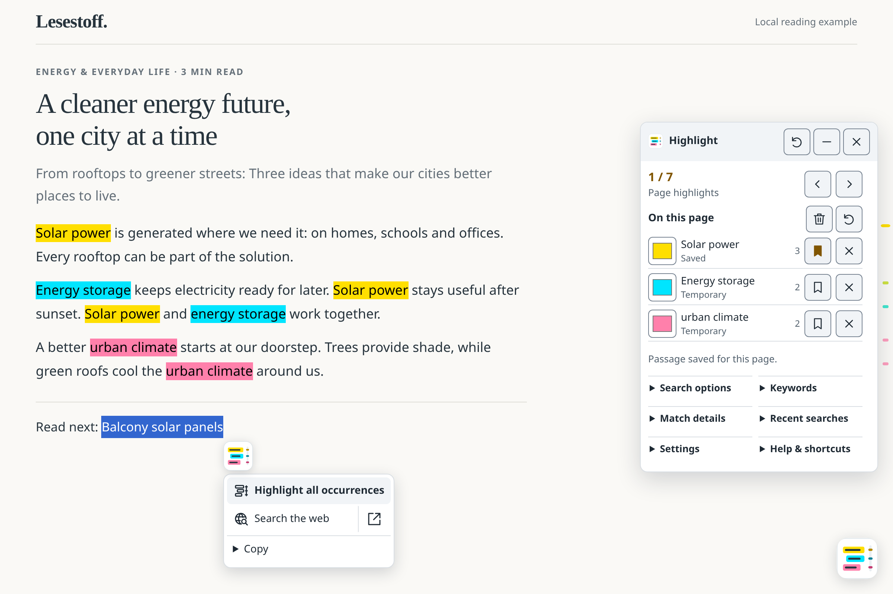

<picture><source media="(prefers-color-scheme: dark)" srcset="assets/icon-dark.svg"></picture>

# Slim Search Highlight

[Deutsch](README.md) · [Usage](docs/usage.en.md) · [Documentation](docs/README.md)

 

**Select text, highlight every occurrence and keep your place.** Slim Search Highlight adds colored passages, result navigation and a small selection menu for web searches and quotes to webpages.

A **browser userscript for Tampermonkey and Violentmonkey**. No account, dedicated server or runtime dependencies.

<picture>
  <source media="(prefers-color-scheme: dark)" srcset="assets/screenshot-en.png">
  
</picture>

*The actual interface on a local sample page: three terms, seven matches. This preview follows your GitHub color scheme; the userscript lets you choose Light or Dark yourself.*

## Installation

1. Install [Tampermonkey](https://www.tampermonkey.net/) or [Violentmonkey](https://violentmonkey.github.io/).
2. [Install the script](https://raw.githubusercontent.com/DonVitosurf1/userscript-slim-search-highlight/main/userscript/slim-search-highlight.user.js) and confirm in the manager.
3. Reload the webpage. The userscript manager handles future updates.

Page passages require a browser with **CSS Custom Highlights**. Without that API, persistent keywords and web search remain available. File exports require the manager's download permission.

## Quick start

1. **Select a word, sentence or paragraph.** A logo tile appears next to the selection. Hover over it or click to open the menu; right-click keeps the browser's context menu.
2. Choose **Highlight all occurrences**. Each new passage gets its own vivid color. The panel shows the match count; use its arrows to jump between occurrences.
3. **Save it for this page if needed.** The bookmark saves a passage locally for the same complete URL. Unsaved passages disappear on reload. Manage permanent terms separately under **Keywords**.

| Action | Shortcut |
|---|---|
| Highlight the selection and every other occurrence | **Alt+Shift+H** · configurable |
| Open / close the panel | **Alt+Shift+P** |
| Previous / next match | **Alt+Left / Right** |

Hover hints show the available shortcuts. If Alt+Shift+P is already assigned to highlighting, that assignment takes priority. The logo at the screen edge always opens the panel.

## More features

- **Web searches and quotes:** The left side of “Search the web” opens a new tab in the same browser window; the arrow on the right opens a separate window. Copy quotes with their source or links to selected text; export passages as Markdown and saved pages as JSON.
- **Use your Google search words:** With automatic search-word transfer enabled, opening a result highlights your search terms on the destination page.
- **Adjust the appearance:** Under **Settings → Appearance**, choose Light/Dark, transparency, and the panel opener's size and position. Preferences are saved locally.

Saved passages, keywords and preferences stay local in your userscript manager. An explicit web search sends the selected text to your chosen search engine. See the [security model](docs/security-model.md) for details and limitations.

The [usage guide](docs/usage.en.md) covers saving, search options and exports. For common issues, see [Troubleshooting](docs/usage.en.md#troubleshooting).

## Further information

- [Documentation index](docs/README.md)
- [Design guideline and icons (German)](docs/design/README.md) · [Technical design system](docs/design/DESIGN.md)
- [Development and tests](docs/development.md) · [Contributing](.github/CONTRIBUTING.md)
- [Changelog](CHANGELOG.md) · [Security model](docs/security-model.md) · [Report a vulnerability](SECURITY.md)
- [MIT license](LICENSE)
