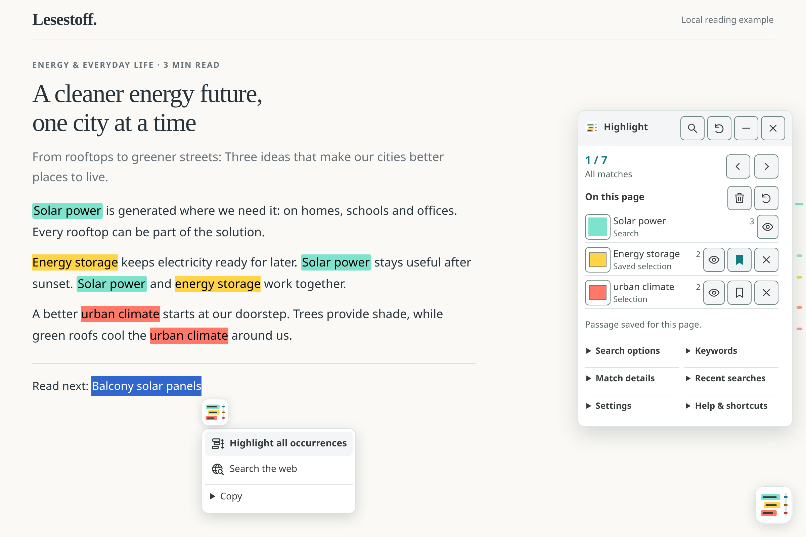
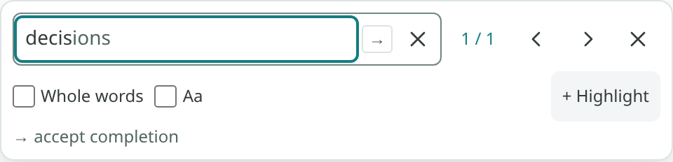
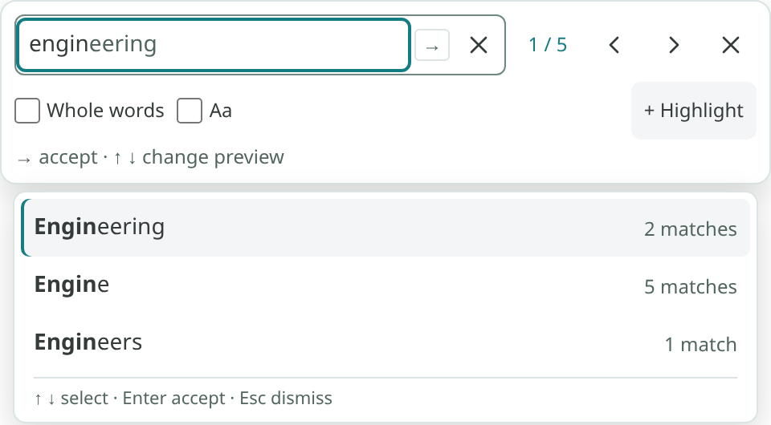

<picture><source media="(prefers-color-scheme: dark)" srcset="assets/icon-dark.svg"></picture>

# Slim Search Highlight

[Deutsch](README.md) · [Usage](docs/usage.en.md) · [Documentation](docs/README.md)

 

**Select text, highlight every occurrence and keep your place.** Slim Search Highlight adds colored passages, result navigation and a selection menu for web searches and quotes to webpages. Quick find searches the page and completes words from its content.

A **browser userscript for Tampermonkey and Violentmonkey**. No account, dedicated server or runtime dependencies.

## Installation

1. Install [Tampermonkey](https://www.tampermonkey.net/) or [Violentmonkey](https://violentmonkey.github.io/).
2. [Install the userscript](https://raw.githubusercontent.com/DonVitosurf1/userscript-slim-search-highlight/main/userscript/slim-search-highlight.user.js) and confirm in the manager.
3. Reload the webpage. Your userscript manager handles updates; you can also check for them manually there.

Page passages and quick find require **CSS Custom Highlights**. Without that browser API, permanent keywords and web search remain available.

## Highlight and navigate

1. **Select a word, sentence or paragraph.** A logo tile appears beside it. Hover over the tile or click to open the menu; right-click keeps the browser's context menu.
2. Choose **Highlight all occurrences**. Each new passage gets its own vivid color. The panel arrows move through visible matches.
3. **Save it for this page if needed.** The bookmark saves the passage locally for the same complete URL. Unsaved passages disappear on reload or a URL change. Manage permanent terms separately under **Keywords**.

<picture>
  <source media="(prefers-color-scheme: dark)" srcset="assets/screenshot-en.png">
  
</picture>

*The current userscript on a local sample page: Solar power from a search, Energy storage as a saved selection and urban climate as a temporary selection – seven matches in total.*

**On this page** combines search terms and your selections with colors, match counts and sources. The **eye toggle** temporarily hides a term while retaining its row. Reloading or changing the URL resets visibility. The panel opens **at the right-center of the visible browser window** by default; a custom position is retained.

## Quick find with word suggestions

**Ctrl+Shift+F** or the **panel magnifier** opens the search bar. Typing temporarily highlights occurrences of your query. After **three characters of a single word**, it suggests matching words from visible page text:

<table>
  <thead><tr><th align="left">One word suggestion</th><th align="left">Multiple word suggestions</th></tr></thead>
  <tbody><tr>
    <td valign="top" width="50%"><picture><source media="(prefers-color-scheme: dark)" srcset="assets/find-completion-single-en.png"></picture></td>
    <td valign="top" width="50%"><picture><source media="(prefers-color-scheme: dark)" srcset="assets/find-completion-en.png"></picture></td>
  </tr></tbody>
</table>

*Two states of the same search bar, captured from the actual userscript. Images follow your GitHub color scheme; the script's Light/Dark setting remains your choice.*

- **One candidate:** a gray inline suffix. **Multiple candidates:** also a list of up to three words with match counts.
- **Up / Down** change the selected list word and its inline preview together. **Right arrow at the end of the input**, the small arrow button or clicking a list word accepts it.
- **Enter** accepts an active list selection, then navigates matches. **Shift+Enter** goes back. **Escape** dismisses suggestions first, then closes the finder.
- **+ Highlight** adopts the typed text as a temporary page selection. Only the bookmark saves it. Adoption uses the panel's page-selection search options.

The bar stays **at the top-center of the visible browser viewport**, including when you have scrolled down. A new search brings the **first match on the entire page** into view; that match may be above your reading position.

Suggestions come from local page text. They save no history and change the query only after acceptance. **Whole words** and **Aa** control matching; one suggested word can have several matches. [Details and limits](docs/usage.en.md#search-completion).

## Keyboard at a glance

| Action | Shortcut |
|---|---|
| Highlight the selection and every other occurrence | **Alt+Shift+H** · configurable |
| Open / close the panel | **Alt+Shift+P** |
| Open quick find | **Ctrl+Shift+F** · configurable |
| Previous / next panel match | **Alt+Left / Right** |

Hover hints show available shortcuts. If Alt+Shift+P is assigned to highlighting, that assignment takes priority. Browsers and other extensions can reserve their own shortcuts.

## More features

- **Use your Google search words:** With automatic search-word transfer enabled, opening a result highlights its search terms. Your own selections add to these matches and share navigation and counts.
- **Internal website search:** Enable capture for the current website in Settings, with **Automatically capture search terms** also enabled. Recognized words appear with the source **Website search**. [Usage and supported flows](docs/usage.en.md#internal-website-search).
- **Web search, quotes and export:** “Search the web” opens selected text in a new tab. Copy quotes with their source or links to selected text; export passages as Markdown and saved pages as JSON. File exports require the manager's download permission.
- **Appearance:** Under **Settings → Appearance**, choose Light/Dark, transparency, and the panel opener's size and position. “Sunlit Mint” combines white or green-charcoal surfaces, mint/teal controls and eight shared highlight colors. Saved custom colors stay intact.

Passages, keywords and preferences stay local in your userscript manager. An explicit web search sends selected text to your chosen search engine. [Security model and limits](docs/security-model.md).

## Further information

- [Usage](docs/usage.en.md) · [Troubleshooting](docs/usage.en.md#troubleshooting)
- [Documentation index](docs/README.md) · [Changelog](CHANGELOG.md)
- [Design guideline (German)](docs/design/README.md) · [Technical design system](docs/design/DESIGN.md)
- [Development and tests](docs/development.md) · [Contributing](.github/CONTRIBUTING.md)
- [Report a vulnerability](SECURITY.md) · [MIT license](LICENSE)
