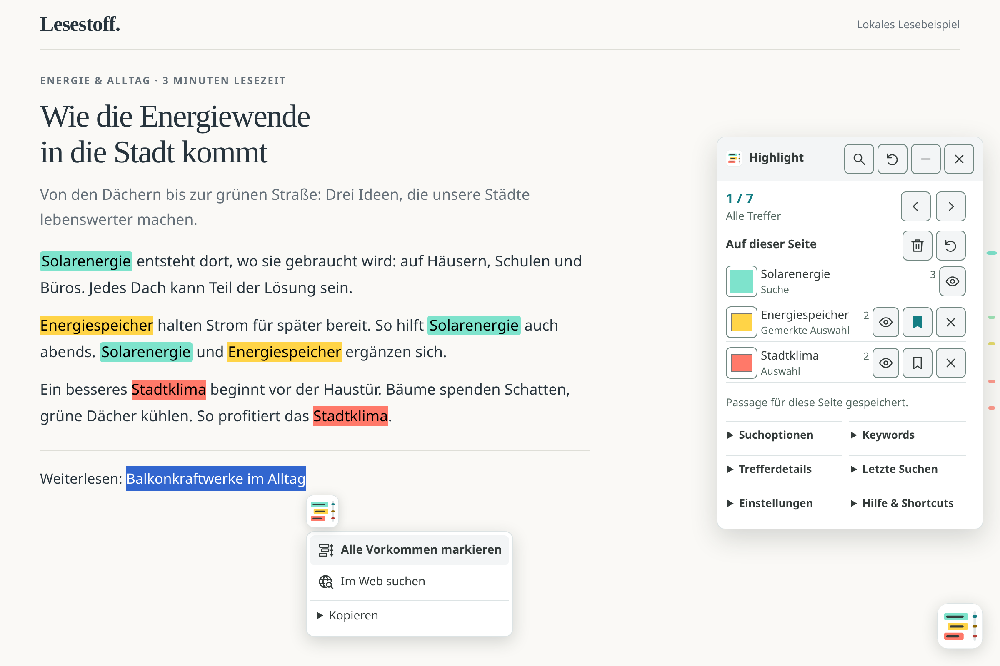
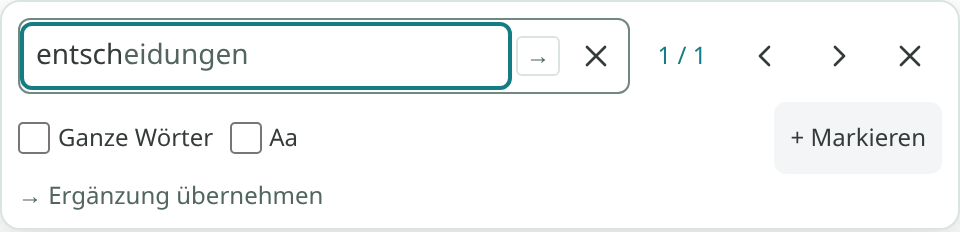
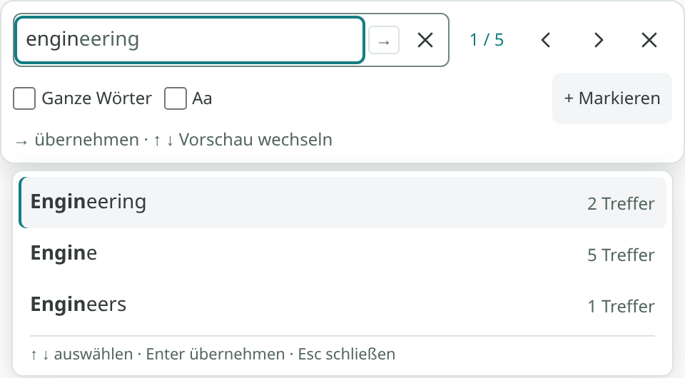

<picture><source media="(prefers-color-scheme: dark)" srcset="assets/icon-dark.svg"></picture>

# Slim Search Highlight

[English](README.en.md) · [Bedienung](docs/usage.de.md) · [Dokumentation](docs/README.md)

 

**Text auswählen, alle Vorkommen markieren und gezielt weiterlesen.** Slim Search Highlight ergänzt Webseiten um farbige Markierungen, Treffernavigation und ein Auswahlmenü für Websuche und Zitate. Die Schnellsuche findet Text direkt auf der Seite und vervollständigt Wörter aus deren Inhalt.

Ein **Browser-Userscript für Tampermonkey und Violentmonkey**. Kein Konto, kein eigener Server, keine Laufzeitabhängigkeiten.

## Installation

1. [Tampermonkey](https://www.tampermonkey.net/) oder [Violentmonkey](https://violentmonkey.github.io/) installieren.
2. [Userscript installieren](https://raw.githubusercontent.com/DonVitosurf1/userscript-slim-search-highlight/main/userscript/slim-search-highlight.user.js) und im Manager bestätigen.
3. Webseite neu laden. Weitere Updates erfolgen über den Userscript-Manager; dort lässt sich auch manuell nach Updates suchen.

Seitenmarkierungen und Schnellsuche benötigen **CSS Custom Highlights**. Ohne diese Browser-API bleiben dauerhafte Keywords und die Websuche verfügbar.

## Markieren und navigieren

1. **Wort, Satz oder Absatz auswählen.** Eine Logo-Kachel erscheint neben der Auswahl. Darüberfahren oder anklicken öffnet das Menü; Rechtsklick öffnet weiterhin das Browser-Kontextmenü.
2. **Alle Vorkommen markieren** wählen. Jede neue Passage bekommt eine eigene kräftige Farbe. Die Pfeile im Panel springen durch die eingeblendeten Treffer.
3. **Bei Bedarf für diese Seite merken.** Das Lesezeichen speichert die Passage lokal für dieselbe vollständige URL. Eine ungespeicherte Markierung verschwindet beim Neuladen oder Wechsel der URL. Dauerhafte Begriffe bleiben separat unter **Keywords**.

<picture>
  <source media="(prefers-color-scheme: dark)" srcset="assets/screenshot.png">
  
</picture>

*Aktuelles Userscript auf einer lokalen Beispielseite: Solarenergie aus einer Suche, Energiespeicher als gemerkte und Stadtklima als temporäre Auswahl – zusammen sieben Treffer.*

Unter **Auf dieser Seite** stehen Suchbegriffe und eigene Markierungen gemeinsam mit Farbe, Trefferzahl und Herkunft. Der **Auge-Schalter** blendet einen Begriff vorübergehend aus. Seine Zeile bleibt erhalten; Neuladen oder ein URL-Wechsel setzt die Sichtbarkeit zurück. Das Panel öffnet sich standardmäßig **rechts mittig im sichtbaren Browserfenster**; eine selbst gewählte Position bleibt gespeichert.

## Schnellsuche mit Wortvorschlägen

**Strg+Shift+F** oder die **Lupe im Panel** öffnet die Suchleiste. Beim Tippen werden die Vorkommen des Suchtexts vorübergehend markiert. Ab **drei Zeichen eines einzelnen Worts** erscheinen passende Wörter aus dem sichtbaren Seitentext:

<table>
  <thead><tr><th align="left">Ein Wortvorschlag</th><th align="left">Mehrere Wortvorschläge</th></tr></thead>
  <tbody><tr>
    <td valign="top" width="50%"><picture><source media="(prefers-color-scheme: dark)" srcset="assets/find-completion-single.png"></picture></td>
    <td valign="top" width="50%"><picture><source media="(prefers-color-scheme: dark)" srcset="assets/find-completion.png"></picture></td>
  </tr></tbody>
</table>

*Zwei Zustände derselben Suchleiste, aufgenommen mit dem echten Userscript. Die Bilder folgen deinem GitHub-Farbschema; im Programm wählst du Hell oder Dunkel selbst.*

- **Ein Vorschlag:** graue Ergänzung direkt im Feld. **Mehrere:** zusätzlich eine Liste mit bis zu drei Wörtern und Trefferzahlen.
- **↑ / ↓** wechseln Listenauswahl und graue Vorschau gemeinsam. **→ am Ende der Eingabe**, der kleine Pfeil oder ein Klick auf ein Listenwort übernimmt den Vorschlag.
- **Enter** übernimmt eine aktive Listenauswahl; danach navigiert es durch die Treffer. **Shift+Enter** geht zurück. **Escape** blendet zuerst Vorschläge aus und schließt anschließend die Suchleiste.
- **+ Markieren** übernimmt den eingegebenen Text als temporäre Seitenmarkierung. Erst das Lesezeichen speichert sie. Dabei gelten die Seiten-Suchoptionen im Panel.

Die Leiste sitzt **oben mittig im aktuell sichtbaren Browserbereich**, auch wenn du weit nach unten gescrollt hast. Eine neue Suche springt zum **ersten Treffer der gesamten Seite**; dieser kann weiter oben liegen.

Die Vorschläge entstehen lokal aus Seitentext. Sie speichern keinen Verlauf und ändern die Eingabe erst nach der Übernahme. **Ganze Wörter** und **Aa** steuern die Suche; ein Wortvorschlag kann mehrere Treffer haben. [Details und Grenzen](docs/usage.de.md#suchvervollständigung).

## Tastatur auf einen Blick

| Aktion | Tastenkombination |
|---|---|
| Auswahl und alle weiteren Vorkommen markieren | **Alt+Shift+H** · einstellbar |
| Panel öffnen / schließen | **Alt+Shift+P** |
| Schnellsuche öffnen | **Strg+Shift+F** · einstellbar |
| Vorheriger / nächster Treffer im Panel | **Alt+← / →** |

Hover-Hinweise zeigen die verfügbaren Shortcuts. Ist Alt+Shift+P bereits als Markieren-Shortcut vergeben, hat diese Belegung Vorrang. Browser und andere Erweiterungen können eigene Tastenkombinationen belegen.

## Weitere Funktionen

- **Google-Suchwörter übernehmen:** Bei aktivierter automatischer Übernahme werden die Suchwörter auf geöffneten Ergebnissen markiert. Eigene Markierungen ergänzen sie; gemeinsame Navigation und Zähler bleiben erhalten.
- **Interne Website-Suche:** Unter Einstellungen für die aktuelle Website freigeben; **Automatisch von Suche übernehmen** muss ebenfalls aktiv sein. Erkannte Suchwörter erscheinen mit der Herkunft **Website-Suche**. [Bedienung und unterstützte Abläufe](docs/usage.de.md#interne-website-suche).
- **Websuche, Zitate und Export:** „Im Web suchen“ öffnet die Auswahl in einem neuen Tab. Zitate mit Quelle und Links zur Textstelle kopieren; Passagen als Markdown und gespeicherte Seiten als JSON exportieren. Datei-Exporte benötigen die Download-Berechtigung des Managers.
- **Darstellung:** Unter **Einstellungen → Darstellung** Hell/Dunkel und Transparenz wählen sowie Größe und Lage des Panel-Öffners einstellen. „Sunlit Mint“ verbindet weiße oder grün-anthrazitfarbene Oberflächen mit Mint/Türkis und acht gemeinsamen Markierungsfarben. Eigene gespeicherte Farben bleiben erhalten.

Passagen, Keywords und Einstellungen liegen lokal im Userscript-Manager. Eine ausdrücklich gestartete Websuche übergibt den ausgewählten Text an die gewählte Suchmaschine. [Sicherheitsmodell und Grenzen](docs/security-model.md).

## Weitere Informationen

- [Bedienung](docs/usage.de.md) · [Problemlösungen](docs/usage.de.md#problemlösungen)
- [Dokumentationsübersicht](docs/README.md) · [Änderungen](CHANGELOG.md)
- [Designrichtlinie und Symbole](docs/design/README.md) · [Technisches Designsystem](docs/design/DESIGN.md)
- [Entwicklung und Tests](docs/development.md) · [Mitwirken](.github/CONTRIBUTING.md)
- [Sicherheitsproblem melden](SECURITY.md) · [MIT-Lizenz](LICENSE)
