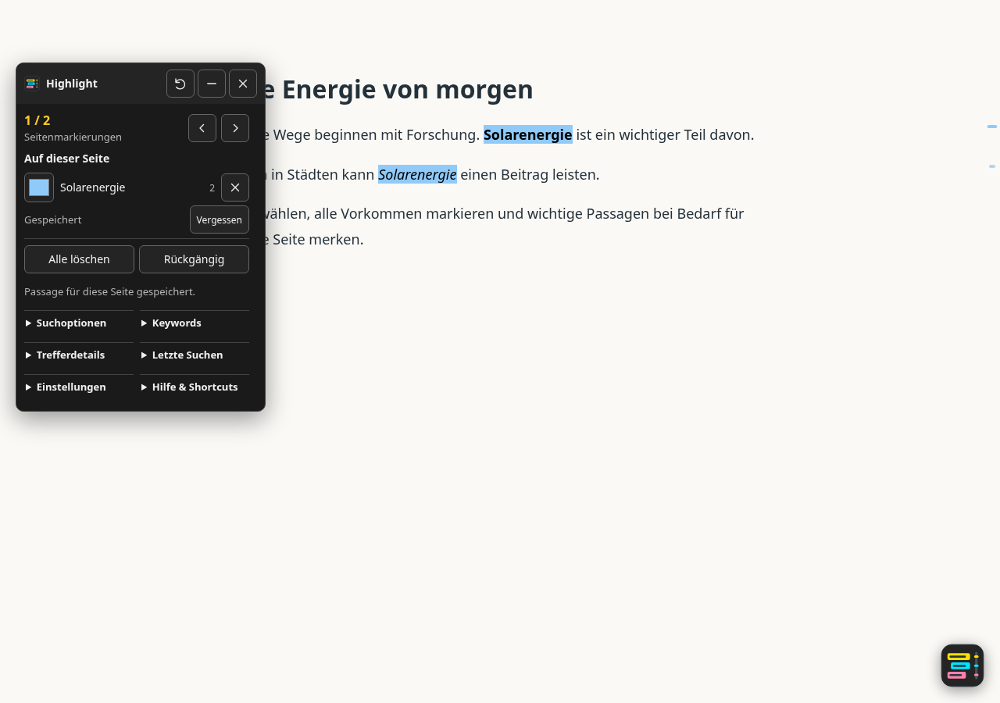

<picture><source media="(prefers-color-scheme: dark)" srcset="assets/icon-dark.svg"></picture>

# Slim Search Highlight

[English](README.en.md) · [Bedienung](docs/usage.de.md) · [Dokumentation](docs/README.md)

 

Wörter, Sätze oder Absätze auf Webseiten auswählen und alle Vorkommen markieren. Ein lokales Userscript für Tampermonkey und Violentmonkey – ohne Konto, Server oder Laufzeitabhängigkeiten.

## Installation

1. [Tampermonkey](https://www.tampermonkey.net/) oder [Violentmonkey](https://violentmonkey.github.io/) installieren.
2. [Skript installieren](https://raw.githubusercontent.com/DonVitosurf1/userscript-slim-search-highlight/main/userscript/slim-search-highlight.user.js) und im Manager bestätigen.
3. Webseite neu laden. Weitere Updates erfolgen über den Userscript-Manager.

Seitenmarkierungen benötigen **CSS Custom Highlights**. Ohne diese Browser-API bleiben dauerhafte Keywords und ausdrückliche Websuche verfügbar. Für Datei-Exporte benötigt der Manager die Download-Berechtigung.

## Schnellstart

- Text auswählen → das Logo-Symbol öffnen → **Alle Vorkommen markieren**. Alternativ **Alt+Shift+H** verwenden; der Shortcut ist einstellbar.
- Jede neue Passage bekommt eine andere kräftige Farbe. Mit den Pfeilen oder **Alt+← / →** durch die Treffer wechseln.
- **Merken** speichert eine Passage lokal für diese URL. Ohne diese Aktion bleiben Seitenmarkierungen temporär; **Keywords** verwaltet dauerhafte Begriffe getrennt.
- **Im Web suchen** startet ausdrücklich eine Websuche. Rechtsklick bleibt beim Browser.

Google-Suchwörter automatisch übernehmen, Farben ändern, rückgängig machen, zitieren, exportieren und das helle/dunkle Farbschema einstellen: [vollständige Bedienungsanleitung](docs/usage.de.md).

## Weitere Informationen

- [Dokumentationsübersicht](docs/README.md)
- [Designrichtlinie und Symbole](docs/design/README.md)
- [Entwicklung und Tests](docs/development.md) · [Mitwirken](.github/CONTRIBUTING.md)
- [Änderungen](CHANGELOG.md) · [Sicherheitsmodell](docs/security-model.md) · [Sicherheitsproblem melden](SECURITY.md)
- [MIT-Lizenz](LICENSE)
