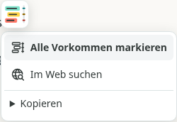
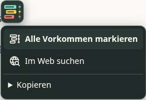

# Designrichtlinie

[Dokumentation](../README.md) · [Technisches Designsystem](DESIGN.md)

## Leitidee: eine markierte Seite

Slim Search Highlight ist ein Lesewerkzeug. Die Gestaltung erinnert an markierten Text auf cremefarbenem Papier: ruhig im Umfeld, kräftig an den Fundstellen. Das Logo zeigt drei farbige Textzeilen und eine schmale Trefferleiste. Diese Formen verbinden die Marke mit den tatsächlichen Funktionen.

 

## Farben mit festen Aufgaben

| Rolle | Farbe | Verwendung |
|---|---|---|
| Papier | `#fffaf0` | Helle Arbeitsflächen und helles Logo |
| Tinte | `#343b3a` | Heller Textmodus und Logo-Linien |
| Sonnengelb | `#ffd447` | Erste Markierung, aktiver Seitenfund |
| Mint | `#7ee3cc` | Zweite Markierung, Bedienakzent in Dunkel |
| Koralle | `#ff7969` | Dritte Markierung; dunklere/hellere Verwandte kennzeichnen Fehler |
| Himmelblau | `#49c6e5` | Weitere Markierungen |
| Tiefes Türkis | `#147d83` | Bedienakzent und Tastaturfokus in Hell |
| Grün-Anthrazit | `#202b29` / `#2a3935` | Dunkler Hintergrund und dunkle Bedienelemente |

Das gemeinsame Farbsystem heißt **Sunlit Mint** und folgt der vom Nutzer gelieferten Referenz mit warmem Gelb, Koralle, Mint und Blau. Alle eingebauten Farben stehen zentral in [`src/colors.json`](../../src/colors.json). Das [technische Designsystem](DESIGN.md) dokumentiert die semantischen `--hl-*`-Rollen samt Hell-/Dunkelwerten. Panel, Auswahlmenü, Eingaben, Scrollleisten, Hinweise, Fokus und Hover-/Druckzustände verwenden diese Rollen. Die primäre Aktion ist in Hell tief türkis mit heller Schrift und in Dunkel mint mit dunkler Schrift.

Suchbegriffe und eigene Markierungen verwenden dieselbe Palette mit zwölf Grundfarben. Weitere eigene Begriffe erhalten passende hellere/dunklere Abstufungen; erst wenn alle Familientöne belegt sind, greift eine weitere eindeutige RGB-Farbe. Bereits gespeicherte oder selbst gewählte Farben bleiben unverändert. Die Herkunft steht als Text an der Zeile und wird nicht über eine zweite Farbpalette erklärt.

Das Logo folgt dem gewählten Farbschema: cremefarbener Grund in Hell, Grün-Anthrazit (`#2a3935`) in Dunkel. Die drei Markierungen sind Sonnengelb, Mint und Koralle. Öffnen-Button, Panelkopf und Auswahl-Symbol wechseln sofort gemeinsam, auch ohne Neuladen. Webseitenfarben bleiben davon unabhängig.

Die optionale Transparenz gilt gemeinsam für Panel, Auswahlmenü und Öffnen-Button einschließlich Logo und Beschriftung. Standard ist 0 %; der Regler bietet 0–80 % in 5-%-Schritten, direkte Vorschau und einen eigenen Reset. Hohe Werte machen den Seitentext dahinter sichtbarer und verringern zugleich den Kontrast der Bedienelemente. Seitenmarkierungen werden davon nicht beeinflusst.

Farbe trägt Bedeutung: Markierungsfarben verbinden Text, Farbfeld und Trefferleiste. Zusätzliche Begriffe erhalten automatisch andere kräftige Farben. Beschriftung und Trefferzahl bleiben nötig; Unterscheidung erfolgt nicht ausschließlich über Farbe. Markierungen erhalten automatisch schwarze oder weiße Schrift für lesbaren Kontrast.

## Eine Familie von Symbolen

| Symbol | Bedeutung | Gestaltung |
|---|---|---|
| [Hell](../../assets/icon.svg) / [Dunkel](../../assets/icon-dark.svg) | Programm öffnen / Auswahlaktionen | Zum Farbschema passendes Blatt, drei Markierungen, Trefferleiste |
|  | Alle Vorkommen markieren | Drei wiederholte Markierungen mit Trefferleiste |
|  | Im Web suchen | Weltkugel mit Lupe |

Öffnen-Button, Panelkopf und Auswahl-Symbol verwenden dasselbe vollständige Logo in der zum Farbschema passenden Variante. Das Auswahl-Symbol zeigt die Logo-Kachel ohne zusätzlichen Buttonrahmen. Das Menü erhält eine ruhige passende Fläche, weichen Schatten und 10-px-Radius. Hell/Dunkel, Hover, gedrückter Zustand und Tastaturfokus bleiben erkennbar. Funktions-Icons ergänzen ihre sichtbaren Beschriftungen. Neue Funktions-Icons folgen einem 24×24-Raster mit 1,8 Einheiten Strichstärke, abgerundeten Linienenden und der Textfarbe des aktiven Farbschemas.

| Auswahl-Symbol | Hell | Dunkel |
|---|---|---|
| Logo-Kachel |  |  |

## Form, Schrift und Verhalten

- Systemschrift, 14 px für Bedienelemente, 12–13 px für unterstützende Hinweise; Eingabefelder auf schmalen Bildschirmen mindestens 16 px. Keine externen Schriftarten.
- Kleine Radien: 6 px an Bedienelementen, 8–10 px an Werkzeugflächen. Das Logo hat eine eigene abgerundete Außenform.
- Das Panel bleibt kompakt: Seitenpassagen haben eine Zeile mit Farbe, Begriff, kleinem Speicherstatus, Trefferzahl, Lesezeichen und Entfernen. Papierkorb und Rückgängig stehen neben der Abschnittsüberschrift; ihre Bedeutung bleibt per Tooltip und zugänglichem Namen erkennbar.
- „Auf dieser Seite“ zeigt Suchbegriffe und Auswahlen gemeinsam. Herkunft und Speicherstatus stehen unter dem Begriff; gleiche Begriffe aus beiden Quellen erhalten eine Zeile. Reine Suchbegriffe haben ein Farbfeld ohne Bearbeitungsfunktion, eigene Passagen behalten ihre Speicher- und Bearbeitungsaktionen.
- Der Auge-Schalter gilt nur für die aktuelle URL. Ausgeblendete Zeilen bleiben mit durchgestrichenem Text, Status und null aktiven Treffern erreichbar. Der zugängliche Name bleibt gleich, `aria-pressed` nennt die Sichtbarkeit; der Hovertext erklärt Aus- oder Einblenden. Fokus bleibt nach dem Umschalten beim Begriff. 4-px-Abstände halten die Zeile kompakt; schmale Ansichten haben 44-px-Ziele.
- Ohne gespeicherte Position öffnet das Panel rechts mittig. Positionsreset und Pos1/Home stellen diese automatische Platzierung wieder her. Weitere Werkzeuge bleiben aufklappbar.
- Das Auswahlmenü öffnet unter oder über seinem Logo-Symbol als eigene schmale Fläche. Aktionszeilen teilen eine Oberfläche; die Markieraktion ist dezent betont, „Kopieren“ durch eine Trennlinie abgesetzt. Es gibt keine leere Logo-Spalte und keine Rahmen um jede einzelne Aktion. Desktop-Zeilen sind mindestens 36 px hoch.
- Die Websuche verwendet eine durchgehende beschriftete Aktionszeile und öffnet einen neuen Tab. Hover-/Fokuszustände und ein übersetzter Tooltip erklären die Aktion; die Leseseite bleibt offen.
- Erfolgreiches Kopieren zeigt eine kurze, zugänglich angekündigte Bestätigung beim Menü. Es öffnet kein Hauptpanel und verdrängt keine neue Auswahl. Bei einem Zwischenablagenfehler bleibt das manuelle Kopierfeld im Panel verfügbar. Die Meldung folgt Sprache, Farbschema und Transparenz.
- Symbole dürfen nicht schrumpfen, wenn eine Beschriftung umbricht. Schmale Bildschirme erhalten mindestens 44 px hohe Buttons.
- Tastaturfokus, Hover, gedrückter und deaktivierter Zustand müssen erkennbar bleiben. Ein Symbol allein darf nicht das einzige Feedback sein.
- Hervorheben und Websuche bleiben getrennte, ausdrückliche Aktionen. Rechtsklick bleibt beim Browser; das Auswahl-Symbol öffnet die Aktionen auch ohne Hover per Klick oder Tastatur.
- SVGs sind dekorativ, wenn bereits eine Beschriftung oder ein zugänglicher Buttonname vorhanden ist. Keine doppelten Screenreader-Ansagen.

## Pflege und Prüfung

`assets/icon.svg` und `assets/icon-dark.svg` enthalten die Geometrie der hellen und dunklen Logo-Variante. Ihre mit `data-fill`/`data-stroke` benannten Farbrollen werden beim Build aus `src/colors.json` aktualisiert; `npm run check` erkennt veraltete Ausgaben. Farben daher in der JSON-Datei ändern, nicht separat im SVG. Die Funktions-Icons liegen unter `assets/icons/`; ihre Zuordnung steht in `src/manifest.json`. Der Build bettet diese Dateien in das einzelne Userscript ein. Keine separat gepflegten Base64-Kopien und keine externen Icon-Bibliotheken.

Nach Änderungen: `npm run build`, `npm run check`, Browser-Tests und `npm run screenshots`. Logo und Auswahlaktionen im hellen und dunklen Farbschema sowie auf einem schmalen Bildschirm ansehen. Tastaturbedienung, lesbare Namen, Umbruch und unveränderte Funktionen mitprüfen.
