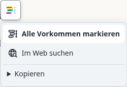
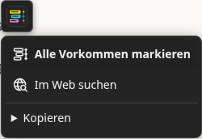

# Designrichtlinie

[Dokumentation](../README.md) · [Technisches Designsystem](DESIGN.md)

## Leitidee: eine markierte Seite

Slim Search Highlight ist ein Lesewerkzeug. Die Gestaltung erinnert an markierten Text auf weißem Papier: ruhig im Umfeld, kräftig an den Fundstellen. Das Logo zeigt drei farbige Textzeilen und eine schmale Trefferleiste. Diese Formen verbinden die Marke mit den tatsächlichen Funktionen.

 

## Farben mit festen Aufgaben

| Rolle | Farbe | Verwendung |
|---|---|---|
| Papier | `#ffffff` | Heller Logo-Grund und helle Arbeitsflächen |
| Tinte | `#253540` | Textlinien im Logo; Bedienelemente verwenden die Textfarbe ihres Farbschemas |
| Gelb | `#ffdf00` | Erste Logo-Markierung; Gelb ist die Signalfarbe für Hervorheben |
| Türkis | `#00e5ff` | Zweite Logo-Markierung |
| Pink | `#ff80ab` | Dritte Logo-Markierung |
| Kontur | `#d9e2e7` | Dezente Begrenzung des weißen Logos |

Die UI-Farben für Hintergrund, Text, Fokus und Fehler stehen als `--hl-*`-Tokens im [Designsystem](DESIGN.md). Das Logo folgt dem gewählten Farbschema: weißer Grund in Hell, dunkelgrauer Grund (`#242424`) in Dunkel. Die drei Markierungsfarben und die Geometrie bleiben identisch. Öffnen-Button, Panelkopf und Auswahl-Symbol wechseln sofort gemeinsam, auch ohne Neuladen. Webseitenfarben bleiben davon unabhängig.

Die optionale Transparenz gilt gemeinsam für Panel, Auswahlmenü und Öffnen-Button einschließlich Logo und Beschriftung. Standard ist 0 %; der Regler bietet 0–80 % in 5-%-Schritten, direkte Vorschau und einen eigenen Reset. Hohe Werte machen den Seitentext dahinter sichtbarer und verringern zugleich den Kontrast der Bedienelemente. Seitenmarkierungen werden davon nicht beeinflusst.

Farbe trägt Bedeutung: Markierungsfarben verbinden Text, Farbfeld und Trefferleiste. Zusätzliche Begriffe erhalten automatisch andere kräftige Farben. Beschriftung und Trefferzahl bleiben nötig; Unterscheidung erfolgt nicht ausschließlich über Farbe. Markierungen erhalten automatisch schwarze oder weiße Schrift für lesbaren Kontrast.

## Eine Familie von Symbolen

| Symbol | Bedeutung | Gestaltung |
|---|---|---|
| [Hell](../../assets/icon.svg) / [Dunkel](../../assets/icon-dark.svg) | Programm öffnen / Auswahlaktionen | Zum Farbschema passendes Blatt, drei Markierungen, Trefferleiste |
|  | Alle Vorkommen markieren | Drei wiederholte Markierungen mit Trefferleiste |
|  | Im Web suchen | Weltkugel mit Lupe |

Öffnen-Button, Panelkopf und Auswahl-Symbol verwenden dieselbe Logo-Datei. Funktions-Icons ergänzen ihre sichtbaren Beschriftungen. Sie ersetzen keine Texte durch unklare Bildzeichen. Neue Funktions-Icons folgen einem 24×24-Raster, einer Strichstärke von 1,8 Einheiten und abgerundeten Linienenden. Sie verwenden die Textfarbe des aktiven Farbschemas, damit sie auch im dunklen Modus lesbar bleiben.

## Form, Schrift und Verhalten

- Systemschrift, 14 px für Bedienelemente, 12–13 px für unterstützende Hinweise; Eingabefelder auf schmalen Bildschirmen mindestens 16 px. Keine externen Schriftarten.
- Kleine Radien: 6 px an Bedienelementen, 8–10 px an Werkzeugflächen. Das Logo hat eine eigene abgerundete Außenform.
- Das Panel bleibt kompakt: Seitenpassagen haben eine Zeile mit Farbe, Begriff, kleinem Speicherstatus, Trefferzahl, Lesezeichen und Entfernen. Papierkorb und Rückgängig stehen neben der Abschnittsüberschrift; ihre Bedeutung bleibt per Tooltip und zugänglichem Namen erkennbar.
- Ohne gespeicherte Position öffnet das Panel rechts mittig. Positionsreset und Pos1/Home stellen diese automatische Platzierung wieder her. Weitere Werkzeuge bleiben aufklappbar.
- Das Auswahlmenü öffnet unter oder über seinem Logo-Symbol als eigene schmale Fläche. Aktionszeilen teilen eine Oberfläche; die Markieraktion ist dezent betont, „Kopieren“ durch eine Trennlinie abgesetzt. Es gibt keine leere Logo-Spalte und keine Rahmen um jede einzelne Aktion. Desktop-Zeilen sind mindestens 36 px hoch.
- Erfolgreiches Kopieren zeigt eine kurze, zugänglich angekündigte Bestätigung beim Menü. Es öffnet kein Hauptpanel und verdrängt keine neue Auswahl. Bei einem Zwischenablagenfehler bleibt das manuelle Kopierfeld im Panel verfügbar. Die Meldung folgt Sprache, Farbschema und Transparenz.
- Symbole dürfen nicht schrumpfen, wenn eine Beschriftung umbricht. Schmale Bildschirme erhalten mindestens 44 px hohe Buttons.
- Tastaturfokus, Hover, gedrückter und deaktivierter Zustand müssen erkennbar bleiben. Ein Symbol allein darf nicht das einzige Feedback sein.
- Hervorheben und Websuche bleiben getrennte, ausdrückliche Aktionen. Rechtsklick bleibt beim Browser; das Auswahl-Symbol öffnet die Aktionen auch ohne Hover per Klick oder Tastatur.
- SVGs sind dekorativ, wenn bereits eine Beschriftung oder ein zugänglicher Buttonname vorhanden ist. Keine doppelten Screenreader-Ansagen.

## Pflege und Prüfung

`assets/icon.svg` und `assets/icon-dark.svg` sind die Originale der hellen und dunklen Logo-Variante. Die Funktions-Icons liegen unter `assets/icons/`; ihre Zuordnung steht in `src/manifest.json`. Der Build bettet diese Dateien in das einzelne Userscript ein. Keine separat gepflegten Base64-Kopien und keine externen Icon-Bibliotheken.

Nach Änderungen: `npm run build`, `npm run check`, Browser-Tests und `npm run screenshots`. Logo und Auswahlaktionen im hellen und dunklen Farbschema sowie auf einem schmalen Bildschirm ansehen. Tastaturbedienung, lesbare Namen, Umbruch und unveränderte Funktionen mitprüfen.
