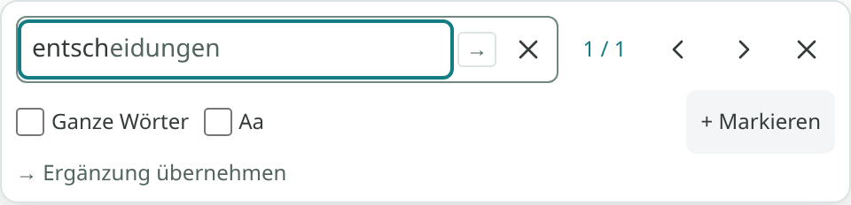
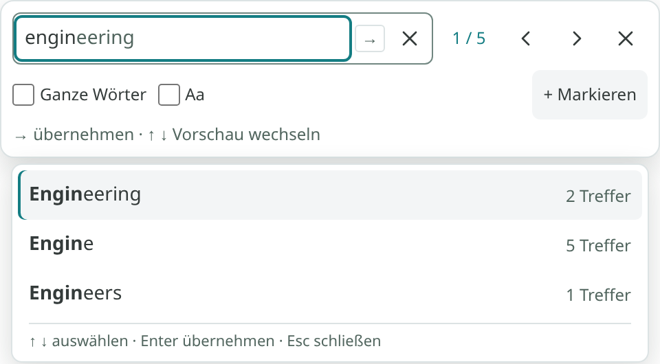
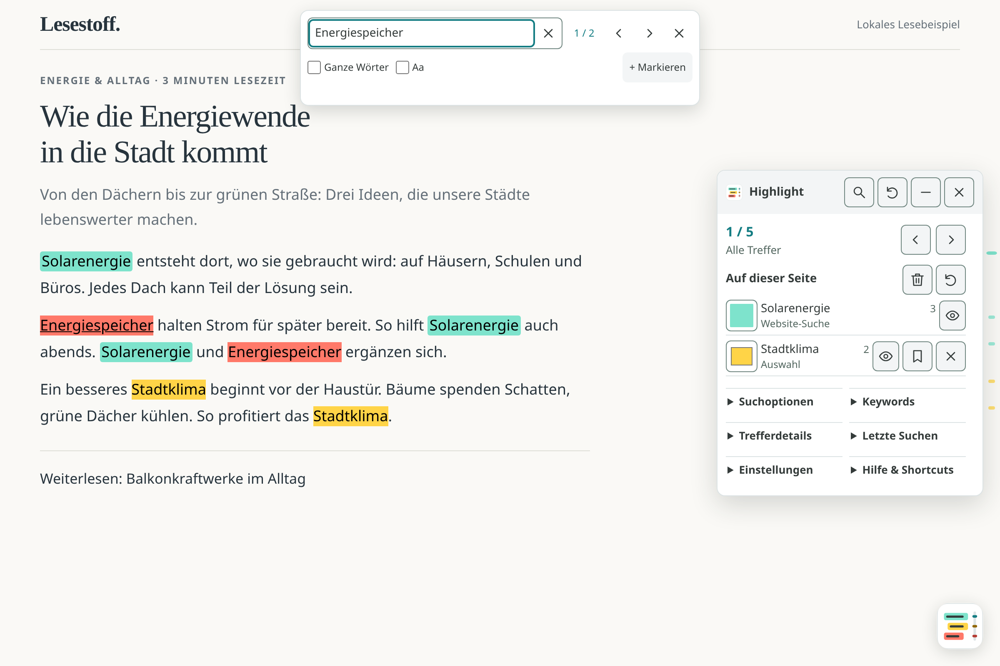
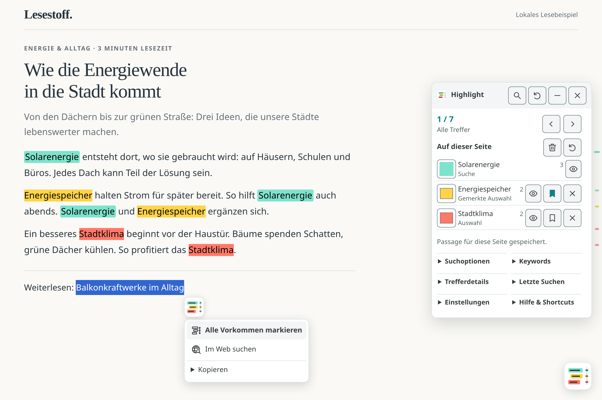

# Bedienung

Bei einem Wechsel von 3.x das alte „Slim Search Highlight Pro v3.10“ entfernen. Einstellungen müssen beim Wechsel auf den stabilen Skriptnamen einmal neu angelegt werden.

[Dokumentationsübersicht](README.md) · [English](usage.en.md)

## Auswählen und suchen

Wort, Satz oder Absatz auf der Webseite auswählen. Das kleine Logo-Symbol erscheint neben der Auswahl; darüberfahren oder anklicken öffnet **Alle Vorkommen markieren** und **Im Web suchen**. Die erste Aktion markiert immer die gewählte Passage und ihre weiteren Vorkommen auf derselben Seite. Websuche und Teilen werden nie automatisch ausgelöst. Der Hovertext am Auswahl-Symbol und an der Markieraktion nennt den aktuell eingestellten Markieren-Shortcut.

**Im Web suchen** öffnet den ausgewählten Text mit der eingestellten Suchmaschine in einem **neuen Tab**. Die Leseseite mit ihren temporären Markierungen bleibt offen. Die Aktionszeile ist durchgehend, ihr Hovertext erklärt das Ziel. Sie ist per Tab erreichbar und mit Enter oder Leertaste bedienbar.

Die Suche ist wörtlich, ohne Beachtung der Groß-/Kleinschreibung, mit vereinheitlichten Leerzeichen und Zeilenumbrüchen. Inline-Formatierung unterbricht sie nicht. Unsichtbarer Text zählt nicht als sichtbarer Wortabstand. Überlappende Fundstellen zählen einmal; bei gleichem Beginn gewinnt die längere Passage. Code, Eingabefelder und eigene Bedienelemente werden ausgelassen. Frames und Shadow-DOM-Inhalte werden nicht durchsucht.

## Google-Suche → Ergebnisseite

Wenn **Einstellungen → Automatisch von Suche übernehmen** aktiv ist, werden die Suchwörter auf geöffneten Ergebnisseiten automatisch hervorgehoben. Das Userscript muss sowohl auf Google als auch auf der Zielseite laufen dürfen; ausgeschlossene Domains bleiben ausgeschlossen.

1. Auf Google suchen und einen Ergebnislink öffnen.
2. Die bestätigte Suchanfrage wird direkt beim Öffnen übernommen – auch nach einer dynamischen Änderung der Google-Suche oder längerer Verweildauer auf der Suchseite.
3. Auf der Zielseite werden die einzelnen Suchwörter markiert. Normale Klicks, Strg-/Cmd-Klicks, Mittelklick und „In neuem Tab öffnen“ aus dem normalen Kontextmenü bleiben verfügbar.

Die Übergabe hängt nicht von Suchparametern im Referrer ab. Es werden keine Suchwörter an Ergebnis-URLs angehängt. Ein lokaler Zwischenspeicher ordnet die Begriffe der angeklickten Ziel-URL zu; bis zu zwölf Zieladressen bleiben zehn Minuten gültig. Der URL-Fragmentteil wird für diese Zuordnung ignoriert. Weiterleitungen auf andere Adressen oder Speziallinks können die Zuordnung verhindern; ein vorhandener Suchmaschinen-Referrer dient als Fallback.

Ein begonnenes, noch nicht abgeschicktes Suchfeld ersetzt die bereits bestätigte URL-Suchanfrage nicht. Fehlt die Anfrage in der URL, wird das Suchfeld als Fallback gelesen. Die Wortsuche filtert kurze Wörter und gängige Stoppwörter; sie ist kein vollständiger Parser für Google-Suchoperatoren. Die automatische Übernahme erzeugt keine dauerhaften Keywords und keine gespeicherten Seitenpassagen. Sie lässt sich jederzeit abschalten; vorhandene explizite `#hl`-/`#sjhl`-Links und manuell im Userscript-Manager gewählte Verlaufseinträge sind davon unabhängig.

## Schnellsuche

**Strg+Shift+F** öffnet eine kompakte Suchleiste; alternativ die **Lupe im Panelkopf** anklicken. Vorhandene Textauswahl wird übernommen. Der Shortcut funktioniert auch aus Eingabefeldern, ohne deren Inhalt zu ändern. Die Leiste sitzt oben mittig im aktuell sichtbaren Browserbereich und bleibt dort auch nach dem Scrollen. Durchsucht wird der Text der gesamten Seite, einschließlich der Bereiche oberhalb und unterhalb des aktuellen Fensterausschnitts. Eine neue Suche springt zum ersten Treffer; dieser kann weiter oben liegen.

- Beim Tippen werden alle Vorkommen des zusammenhängenden Suchtexts im sichtbaren Seitentext außerhalb von Eingabe- und Codebereichen vorübergehend markiert. Teiltreffer sind erlaubt; Groß-/Kleinschreibung wird zunächst ignoriert. Sonderzeichen werden wörtlich gesucht.
- **Ganze Wörter** und **Aa** (Groß-/Kleinschreibung) gelten nur für diese Schnellsuche.
- Die Anzeige **3 / 17**, Pfeile sowie **Enter / Shift+Enter** bewegen sich zwischen den Treffern des aktuellen Suchtexts. Eine aktive Vorschlagsliste verwendet Enter zunächst zur Übernahme; danach navigiert Enter wieder. Der erste Treffer wird bei einer neuen Suche sichtbar gemacht; eine Aktualisierung derselben Suche behält den aktuellen Treffer möglichst bei.
- Das Kreuz im Eingabefeld leert sofort. **Escape** blendet zuerst vorhandene Vervollständigungen aus; ein weiteres Escape oder Schließen entfernt die Suchvorschau und gibt den Fokus zurück. Eigene Markierungen, Suchbegriffe und Keywords bleiben erhalten.
- **+ Markieren** übernimmt den Text als zunächst temporäre Seitenmarkierung. Dabei gelten die Suchoptionen der Seitenmarkierungen im Panel; diese können von den Vorschauoptionen abweichen. Erst das Lesezeichen speichert eine Passage für die Seite.

Die Vorschau speichert weder den Suchtext noch einen Suchverlauf. Unter Einstellungen lässt sich der Such-Shortcut aufzeichnen, deaktivieren oder zurücksetzen. Bestehende Markieren-/Panel-Belegungen haben bei Konflikten Vorrang; die Lupe bleibt bedienbar. Browser oder Erweiterungen können Tastenkombinationen abfangen. `Strg+F` bleibt die native Browser-Suche.

### Suchvervollständigung

Ab **drei Zeichen eines einzelnen Worts** bietet die Schnellsuche passende Wörter aus dem sichtbaren Seitentext an. Ein Vorschlag ergänzt den Text grau im Feld. Bei mehreren erscheinen zusätzlich bis zu drei Wörter mit Trefferzahlen; der erste ist vorausgewählt. Häufig vorkommende Wörter stehen zuerst, bei gleicher Häufigkeit gilt die Seitenreihenfolge. Ein Wortvorschlag kann mehrere Treffer haben; eine einzelne graue Ergänzung bedeutet daher nicht unbedingt nur eine Fundstelle.

- **↑ / ↓** wechseln die Listenauswahl und die graue Ergänzung gemeinsam.
- **→ am Ende der Eingabe**, der kleine Pfeil im Feld oder ein Klick auf ein Listenwort übernimmt den Vorschlag. **Enter** übernimmt die aktive Listenauswahl; ohne Liste navigiert es wie bisher. **Tab** wechselt weiterhin den Fokus.
- **Escape** verwirft die Vorschläge und behält deine Eingabe. Verschieben der Schreibmarke oder Auswählen innerhalb der Eingabe blendet Ergänzungen aus, bis die Schreibmarke wieder am Ende steht. Während einer IME-Eingabe werden keine Vorschläge übernommen.

Die graue Ergänzung verändert weder Eingabe noch Markierungen vor der Übernahme. Die Trefferzahlen entsprechen **Ganze Wörter/Aa**: Ohne „Ganze Wörter“ kann beispielsweise „Engine“ auch innerhalb von „Engineering“ vorkommen. Phrasen und Sonderzeichen bleiben wörtlich suchbar, bekommen aber keine Wortvervollständigung. Pro Suchlauf werden höchstens 256 verschiedene passende Wörter mit maximal 128 UTF-16-Codeeinheiten berücksichtigt; gespeichert wird nichts. Gespeicherte Keywordlisten, Verlauf, unsichtbare Texte, Eingaben und Code sind keine Vorschlagsquellen.

<table>
  <thead><tr><th align="left">Ein Wortvorschlag</th><th align="left">Mehrere Wortvorschläge</th></tr></thead>
  <tbody><tr>
    <td valign="top" width="50%"><picture><source media="(prefers-color-scheme: dark)" srcset="../assets/find-completion-single.png"></picture></td>
    <td valign="top" width="50%"><picture><source media="(prefers-color-scheme: dark)" srcset="../assets/find-completion.png"></picture></td>
  </tr></tbody>
</table>

## Interne Website-Suche

Unter **Einstellungen → Website-Suche hier übernehmen** lässt sich die Funktion für die aktuelle Website aktivieren. **Automatisch von Suche übernehmen** muss ebenfalls eingeschaltet sein. Jede HTTP(S)-Origin – Protokoll, Hostname und Port – wird separat freigegeben; auch Subdomains sind getrennt.

<picture><source media="(prefers-color-scheme: dark)" srcset="../assets/find.png"></picture>

Erkannt werden übliche URL-Parameter wie `q`, `query`, `search`, `s`, `search_query`, `term` oder `keywords`. Ein Suchformular kann außerdem über ein echtes Suchfeld erkannt werden, auch mit individuellem Parameternamen. Formularinhalte werden erst nach einem echten Absende-Klick oder Enter/Leertaste am Absende-Button übernommen. Tippen und ein allein per JavaScript ausgelöstes `requestSubmit()` reichen nicht.

Die Suchwörter erscheinen mit Herkunft **Website-Suche**. Beim Öffnen eines Ergebnislinks innerhalb derselben Origin werden sie auf das Ziel übernommen, auch bei Mittelklick oder neuem Tab. Externe Links erhalten keine Website-Suchbegriffe. Bestätigte AJAX-Suchen ohne URL-Wechsel sowie native GET-/POST-Formulare werden unterstützt; geänderte URLs werden auch ohne vollständiges Neuladen erkannt.

Eine neue Website-Suche ersetzt ihre vorherige Anfrage. Bereits vorhandene eigene Markierungen auf derselben URL und dauerhafte Keywords bleiben erhalten. Abschalten entfernt die aktive Website-Suchquelle; nach erneutem Einschalten werden alte Übergaben aus der vorherigen Freigabe nicht wiederhergestellt. Eine noch vorhandene Suchanfrage in der aktuellen URL kann erneut erkannt werden.

Übergaben gelten für neue Zielseiten fünf Minuten und sind auf zwölf Einträge begrenzt. Bereits übernommene Begriffe bleiben auf ihrer Seite erhalten. Sie bleiben lokale Userscript-Manager-Daten; Website-Suchen erzeugen keine dauerhaften Keywords, gespeicherten Passagen oder Einträge im gemeinsamen Suchverlauf. Eingabefelder mit Passwörtern und mehrdeutige Suchformulare werden nicht übernommen.

Grenzen: Individuelle JavaScript-Suchbuttons ohne erkennbaren URL-Suchparameter bzw. bestätigte native Formularaktivierung benötigen eine passende Seitenregel. Beliebige Weiterleitungen können die genaue Zielzuordnung unterbrechen; die bekannte Wikipedia-Weiterleitung von `/w/index.php` zu einem direkten `/wiki/Titel` wird berücksichtigt. Geschlossene Shadow-DOM-Inhalte, fremde Frames und Browser-PDF-Ansichten werden weiterhin nicht durchsucht.

## Farben, Löschen und Rückgängig

Unter **Auf dieser Seite** stehen Suchbegriffe und eigene Auswahlen in einer gemeinsamen Übersicht. **Suche** kennzeichnet übernommene Suchwörter, **Auswahl** eigene temporäre Markierungen und **Gemerkte Auswahl** gespeicherte Seitenpassagen. Stammt derselbe Begriff aus Suche und Auswahl, erscheint er einmal mit beiden Quellen. Die Trefferzahl zählt aktive Fundstellen aus beiden Suchwegen, identische Textbereiche einmal. Dauerhafte Keywords ohne entsprechende Suchanfrage bleiben im separaten Bereich **Keywords**.

Unter **Auf dieser Seite** bekommt jede neue Passage automatisch eine andere, kräftige Farbe und eine Trefferzahl. Alle Vorkommen derselben Passage teilen ihre Farbe. Bereits belegte Farben, auch von aktiven Keywords, werden bei der Vergabe übersprungen; passende Farbabstufungen folgen, wenn die Startpalette aufgebraucht ist. Suchbegriffe und eigene Markierungen verwenden dieselben acht Grundfarben; ab dem neunten Begriff folgen Farben mit möglichst großem Abstand zu den belegten Farben. Die Beschriftung nennt ihre Herkunft. Über das Farbfeld lässt sich die Farbe weiterhin selbst wählen. Erneutes Markieren derselben Passage und Wiederherstellen gespeicherter Passagen behalten deren Farbe.

Farbe, Begriff, Trefferzahl, Sichtbarkeit und gegebenenfalls Lesezeichen und Entfernen stehen in einer kompakten Zeile; Herkunft und Speicherstatus direkt unter dem Begriff. Eigene Passagen haben ein bearbeitbares Farbfeld, reine Suchbegriffe eine Farbanzeige. Bei einer gemeinsamen Zeile verändert das Farbfeld die eigene Seitenmarkierung; Suchwort-Markierungen außerhalb ihres Suchbereichs behalten ihre Suchfarbe. Das Kreuz entfernt eine eigene Passage. Das **Papierkorb-Symbol neben „Auf dieser Seite“** löscht nur die eigenen Markierungen; übernommene Suchbegriffe bleiben erhalten. Der **Zurück-Pfeil daneben** macht die letzte Änderung an eigenen Passagen rückgängig, einschließlich Farbe und Speicherstatus. Die Buttons haben erklärende Tooltips und zugängliche Namen. Die letzten 20 Seitenzustände bleiben während der Sitzung erhalten; Navigation oder Neuladen beendet diesen Verlauf.

Vor/Zurück und **Alt+← / →** navigieren gemeinsam durch die eingeblendeten Seitenmarkierungen, Google-Suchbegriffe und passenden gespeicherten Keywords, in ihrer Reihenfolge auf der Seite. Neue Markierungen ergänzen die bisherigen Treffer. Markieren eine eigene Passage und ein Keyword exakt denselben Textbereich, zählt er einmal; die eigene Markierung ist dort das Navigationsziel. Einzelne Suchwörter innerhalb längerer markierter Passagen bleiben separat erreichbar. Der Zähler zeigt **Alle Treffer**. Die Positionsleiste bündelt bei vielen Treffern bis zu 500 Markierungen; die Trefferdetails zeigen bis zu 300 Einträge. Alle tatsächlichen Treffer bleiben über die Navigation erreichbar. Suchbegriffe werden durch das Ergänzen einer Passage nicht dauerhaft gespeichert.

## Begriffe vorübergehend ausblenden

Der **Auge-Schalter** schaltet alle Markierungen des jeweiligen Begriffs auf dieser Seite aus oder wieder ein. Das gilt auch dann gemeinsam, wenn er aus Suche und Auswahl stammt oder zusätzlich als dauerhaftes Keyword gespeichert ist. Die Zeile bleibt mit **Ausgeblendet**, einem durchgestrichenen Begriff und **0** aktiven Treffern erhalten. Zähler, Trefferdetails, Navigation und Positionsleiste zeigen nur eingeblendete Treffer. Auch nachgeladener Text respektiert den Schalter. Eine andere, längere markierte Passage kann denselben Text weiterhin hervorheben; ihre Sichtbarkeit bleibt unabhängig.

Der Schalter schreibt keine gespeicherten Daten und ist unabhängig vom Rückgängig-Verlauf. Neuladen oder ein Wechsel der vollständigen URL setzt ihn zurück. Gespeicherte Passagen und dauerhafte Keywords bleiben erhalten und werden wieder angezeigt. Erneutes Auswählen und Markieren eines ausgeblendeten Begriffs blendet ihn ebenfalls wieder ein. Tastatur: mit Tab den Auge-Schalter fokussieren und mit Enter oder Leertaste umschalten; der Fokus bleibt beim Begriff. Die Hovertexte nennen die jeweilige Aktion.

## Für diese Seite merken

| Art | Gültigkeit | Speicherung |
|---|---|---|
| Temporäre Seitenmarkierung | Aktuelle Seite, alle Vorkommen der Passage | Nur in dieser Sitzung; verschwindet beim Neuladen oder Navigieren |
| Gemerkte Seitenpassage | Dieselbe vollständige URL | Erst nach Klick auf das Lesezeichen lokal im Userscript-Manager |
| Dauerhaftes Keyword | Alle passenden Seiten bzw. eingeschränkte Domains | Separater Bereich „Keywords“ |

Eigene Markierungen sind zunächst temporär. Das **Lesezeichen-Symbol (Für diese Seite merken)** speichert die jeweilige Passage mit Farbe und Textkontext lokal im Userscript-Manager. Ein gefülltes Lesezeichen und **Gemerkte Auswahl** zeigen den Speicherstatus. Bei einem Wiederbesuch wird genau dieser Text erneut gesucht. Wenn er fehlt, steht **Nicht gefunden** an der Passage; es wird kein ähnlicher Text automatisch eingesetzt.

Erneutes Klicken auf das Lesezeichen (**Gespeicherte Passage vergessen**) entfernt den gespeicherten Eintrag, lässt die aktuelle temporäre Markierung aber stehen. Entfernen/Leeren aktualisiert ebenfalls gespeicherte Einträge; Rückgängig kann das in derselben Sitzung zurücknehmen. Speicherung erfolgt pro vollständiger URL einschließlich Query und Fragment. Zwei Tabs mit derselben URL verwenden beim Speichern den zuletzt geschriebenen Zustand.

Bei einem Speicherfehler bleibt der vorherige Zustand erhalten und die Anwendung meldet den Fehler. Unbekannte Datenversionen werden nicht überschrieben. **Gespeicherte Seiten exportieren (JSON)** erhält die Daten lokal; ein Datei-Import wird aktuell nicht angeboten.

## Suchoptionen

- **Nur ganze Wörter suchen** verhindert Teiltreffer wie „art“ innerhalb von „start“; Buchstaben und Zahlen einschließlich Unicode werden berücksichtigt.
- **Nur Artikel** begrenzt den Bereich auf `article`, ersatzweise `main` oder `[role=main]`. Fehlt ein solcher Bereich, nennt die Anwendung den Grund und erweitert die Suche nicht still auf die gesamte Seite.

Die Optionen gelten für die aktuellen Seitenmarkierungen und werden mit ausdrücklich gespeicherten Passagen für diese URL übernommen.

## Kopieren und Export

Im Auswahlmenü **Kopieren** öffnen:

- **Zitat mit Quelle kopieren** kopiert den ausgewählten Text samt Seiten-URL im gewählten Format Klartext oder Markdown.
- **Link zur Textstelle kopieren** erzeugt bei unterstützten HTTP(S)-Seiten einen `#:~:text=`-Link. Sonst wird der normale Seitenlink kopiert und der Grund angezeigt. Bei mehrfach vorkommendem Text kann der Browser zum ersten passenden Vorkommen springen. Geänderter Text, blockübergreifende Auswahlen oder fehlende Browserunterstützung können die Textverknüpfung ungültig machen.

Erfolgreiches Kopieren zeigt für einige Sekunden eine Bestätigung beim Auswahlmenü; das Hauptpanel wird dafür nicht geöffnet. Das Menü erscheint je nach Platz unter oder über dem Auswahl-Symbol. Bei wenig Höhe ist die Menüfläche scrollbar.

Wenn direkter Zwischenablagenzugriff scheitert, öffnet sich das Panel mit einem beschrifteten Textfeld zum manuellen Kopieren. Einstellungen bieten außerdem Markdown-Export der aktuellen Passagen und JSON-Export aller gespeicherten Seiten. Diese Dateien enthalten ausgewählten Text und vollständige URLs; sie werden nur auf ausdrückliche Aktion lokal erzeugt, nicht hochgeladen. Downloads laufen über `GM_download` im Userscript-Manager; dessen Download-Berechtigung muss erlaubt sein. Fehlt diese Unterstützung, meldet das Skript die Einschränkung.

## Darstellung und Öffnen-Button

Das Farbsystem **Sunlit Mint** verbindet Weiß und Grün-Anthrazit mit Türkis/Mint für die Bedienung. Die Markierungspalette enthält Mint, Gelb, Koralle, Blau und verwandte Töne. Gespeicherte oder selbst gewählte Farben bleiben erhalten.

Unter **Einstellungen → Darstellung** stehen **Hell** und **Dunkel** zur Wahl. Panel, Auswahlaktionen und Formularfelder wechseln sofort gemeinsam. Dunkel bleibt die Voreinstellung; Webseitenfarben und die gewählten Markierungsfarben werden nicht verändert.

Das Auswahl-Symbol verwendet dieselbe zum Farbschema passende **Logo-Kachel wie der Panel-Öffner**, ohne zusätzlichen Buttonrahmen. Das Auswahlmenü hat eine dazu passende ruhige Fläche. Größe und Lage des Panel-Öffners lassen sich unabhängig davon einstellen.

**Transparenz der Bedienelemente** lässt Text hinter Panel, Auswahlmenü und Öffnen-Button sichtbar werden. Der Regler reicht von **0 %** (vollständig deckend, Standard) bis **80 %** (stark durchsichtig), in 5-%-Schritten. Logo, Beschriftungen und Bedienelemente werden gemeinsam durchsichtig; die Markierungen im Seitentext behalten ihre Farben. Die Vorschau wirkt sofort, und der gewählte Wert bleibt für weitere Seitenaufrufe gespeichert. **Transparenz zurücksetzen** stellt nur diesen Wert auf 0 % zurück. Für möglichst gut lesbare Bedienelemente eine geringe Transparenz wählen.

Der Öffnen-Button ist standardmäßig **56 px** groß. **Größe des Öffnen-Buttons** lässt sich von 44 bis 80 px verändern; **Größe zurücksetzen** stellt 56 px wieder her. **Position des Öffnen-Buttons** bietet die vier Bildschirmecken. **Abstand zum Rand** reicht von 8 bis 80 px und gilt für beide angrenzenden Ränder. Sichere Bildschirmränder, etwa an Geräten mit Aussparungen, haben Vorrang.

Die Regler für Größe und Randabstand zeigen den aktuellen Pixelwert und lassen sich mit den Pfeiltasten in 4-px-Schritten bedienen. Änderungen gelten sofort und werden lokal für weitere Seitenaufrufe gespeichert. Bei einem Speicherfehler wird die vorherige Einstellung wiederhergestellt. Der Größen-Reset verändert weder Position noch Farbschema.

## Tastatur und Panel

Das Panel ist höchstens 320 px breit und in der zugeklappten Grundansicht auf 560 px bzw. 80 % des sichtbaren Bildschirms begrenzt. Zusätzliche Werkzeuge stehen in zwei Spalten; geöffnete Bereiche nutzen die volle Breite und bei Bedarf mehr Höhe. Hinweise und die aktuelle Tastenkombination stehen unter **Hilfe & Shortcuts**. Schriftgrößen bleiben erhalten; auf schmalen Bildschirmen sind Buttons und Abschnittsüberschriften mindestens 44 px hoch.

Ohne gespeicherte Position öffnet es **rechts, vertikal mittig**, mit möglichst 20 px Randabstand. Die automatische Platzierung passt sich an Fenstergröße und Panelhöhe an. Gespeicherte Positionen werden wiederverwendet; **Panelposition zurücksetzen** im Panelkopf oder **Pos1** auf dem fokussierten Panelkopf stellt die automatische rechte Mittelposition wieder her.

**Alt+Shift+H** führt direkt „Alle Vorkommen markieren“ aus. Unter Einstellungen ist der Shortcut aufzeichenbar, abschaltbar und zurücksetzbar. Alt, Strg oder Meta plus Buchstabe/Ziffer; Shift ist optional. Escape bricht die Aufzeichnung ab. Betriebssystem-/Browserkonflikte sind nicht grundsätzlich vermeidbar.

**Alt+Shift+P** öffnet oder schließt das Panel, auch wenn der Fokus bereits im Panel liegt. Der Hovertext am Panel-Symbol zeigt die Kombination an. In Eingabefeldern, bei IME und Tastenwiederholung greifen diese beiden Shortcuts nicht. Rechtsklick und Doppelklick bleiben nativ; Alt+H speichert keine Keywords mehr.

Kann der Öffnungszustand nicht gespeichert werden, schaltet der Shortcut das Panel trotzdem für die aktuelle Sitzung um. Eine Meldung am Öffnen-Symbol erklärt den Fehler; beim nächsten Besuch kann der zuvor gespeicherte Zustand wieder gelten.

Ist Alt+Shift+P bereits als eigener Markieren-Shortcut gespeichert oder wird neu dafür aufgezeichnet, hat diese Auswahl Vorrang. Die Kombination öffnet dann kein Panel; dessen Hovertext zeigt sie nicht als Panel-Shortcut an. **Hilfe & Shortcuts** erklärt den Konflikt. Durch Ändern oder Zurücksetzen des Markieren-Shortcuts wird Alt+Shift+P wieder für das Panel frei.

| Taste | Aktion |
|---|---|
| Alt+Shift+H | Auswahl und weitere Vorkommen markieren; einstellbarer Standard |
| Alt+Shift+P | Panel öffnen/schließen, sofern nicht dem Markieren zugewiesen |
| Strg+Shift+F | Schnellsuche öffnen/fokussieren; einstellbarer Standard |
| Enter / Shift+Enter im Suchfeld | Nächster/vorheriger Vorschau-Treffer |
| Alt+← / Alt+→ | Vorheriger/nächster Treffer |
| Escape | Auswahlmenü oder Panel schließen; Shortcut-Aufzeichnung abbrechen |
| Pfeiltasten / Shift+Pfeiltasten | Fokussierten Panelkopf verschieben, mit Shift in größeren Schritten |
| Pos1 am Panelkopf | Automatische Panelposition rechts mittig wiederherstellen |

Escape schließt Auswahlaktionen oder Panel und gibt den Fokus zurück. Der Panelkopf ist per Tab und Pfeiltasten verschiebbar; Shift vergrößert die Schritte, Pos1 bzw. Reset setzt die Position zurück. Maus/Touch-Ziehen bleibt möglich. Trefferdetails unterstützen Pfeil hoch/runter, Pos1/Ende und Enter. Reduzierte Bewegung wird respektiert.

## Dauerhafte Keywords und Grenzen

**Keywords** bleibt ein eigener aufklappbarer Bereich für dauerhafte, seitenübergreifende Begriffe, Regex, Farben und Domain-Einschränkungen. Das Panel zeigt nur zur aktuellen Domain passende Einträge. Neue Begriffe mit Enter oder Hinzufügen speichern; Änderungen an Text und Farbe mit **Speichern** oder Enter bestätigen. Das Verlassen eines Felds speichert nicht. Fehler stehen am Feld; die Eingabe bleibt erhalten. Das Ausschließen einer Domain über das Userscript-Menü deaktiviert dort Highlights.

Der Suchverlauf wird ausschließlich im Menü des Userscript-Managers angeboten. Die Auswahl eines Eintrags wendet dessen Begriffe ausdrücklich auf die aktuelle Seite an. Global geltende Keywords sind für Seiten, auf denen sie gelten, erkennbar – auch bei geschlossenem Panel. Für vertrauliche Begriffe Domain-Einschränkungen verwenden. Weitere Grenzen erklärt das [Sicherheitsmodell](security-model.md).

Automatisch übernommene Begriffe und `#hl`-/`#sjhl`-Links werden immer wörtlich gesucht. Nur ausdrücklich gespeicherte Keywords unterstützen einen begrenzten Regex-Umfang; komplexe oder riskante Muster werden abgelehnt.

Seitenmarkierungen brauchen CSS Custom Highlights. Browser-/Manager-Tests auf echten Geräten, Screenreader und mobile Bildschirmtastaturen ergänzen die automatisierte Chromium-Prüfung; es wird keine vollständige WCAG-Zertifizierung behauptet.

## Problemlösungen

**Das Symbol erscheint nicht:** Im Userscript-Manager prüfen, ob das Skript aktiviert ist und auf dieser Seite laufen darf. Auf ausgeschlossenen Domains erscheint keine Oberfläche. Nach einer Installation oder Aktualisierung die Webseite neu laden. Browserinterne Seiten und Inhalte fremder Frames werden nicht wie normale Webseiten bearbeitet.

**Markierungen sind nach dem Neuladen weg:** Temporäre Markierungen werden absichtlich nicht gespeichert. Vorher das Lesezeichen an der Passage aktivieren. Bei gemerkten Passagen prüfen, ob die vollständige URL einschließlich Query und Fragment gleich ist und der ursprüngliche Text noch vorkommt.

**Das Panel steht weiterhin an der alten Position:** Gespeicherte manuelle Positionen bleiben erhalten. Im Panelkopf „Panelposition zurücksetzen“ wählen oder den Panelkopf fokussieren und Pos1 drücken.

**Google-Begriffe fehlen auf der Zielseite:** „Automatisch von Suche übernehmen“ muss aktiv sein; das Skript muss auf Google und der Zielseite ausgeführt werden dürfen. Weiterleitungen können die Zuordnung unterbrechen. Die Übergabe gilt zehn Minuten und fügt der Ziel-URL keine Suchwörter hinzu.

**Ein Shortcut reagiert nicht:** Den Fokus aus Eingabefeldern nehmen und die Belegung unter „Hilfe & Shortcuts“ prüfen. Andere Erweiterungen oder Browser-/Betriebssystemfunktionen können Kombinationen belegen. Für das Markieren lässt sich unter Einstellungen eine andere Kombination aufzeichnen.

**Kopieren oder Export funktioniert nicht:** Bei verweigerter Zwischenablage das manuelle Kopierfeld nutzen. Datei-Exporte benötigen die Download-Unterstützung und -Berechtigung des Userscript-Managers. JSON-Export sichert die Daten; ein Datei-Import wird derzeit nicht angeboten.
