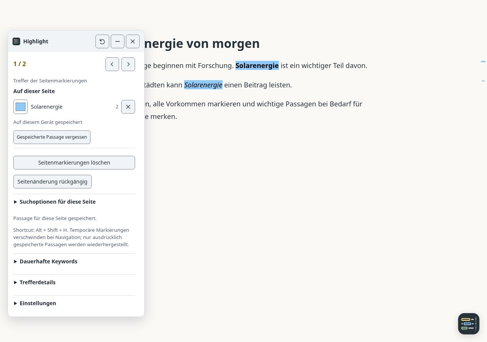

# Usage

When upgrading from 3.x, remove “Slim Search Highlight Pro v3.10”. Settings need to be recreated once when switching to the stable script name.

[Documentation index](README.md) · [Deutsch](usage.de.md)

## Select and find

Select a word, sentence or paragraph. Hover or click the small logo symbol to reveal **Highlight all occurrences** and **Search the web**. Highlighting always finds the full selected passage and its other occurrences on this page. Web search and sharing require an explicit action. Hover hints on the selection symbol and highlight action show the current marking shortcut.

Search is literal, case-insensitive and whitespace-normalized, including line breaks and inline formatting. Invisible text does not invent visible word boundaries. Overlapping matches count once; a longer passage wins at the same start. Code, editing fields and owned controls are excluded. Frames and Shadow DOM content are not searched.

## Google search → result page

Enable **Settings → Take over terms from search** to highlight search words on opened results. The userscript must be allowed to run on both Google and the destination; excluded domains remain excluded.

Search on Google and open a result normally, with Ctrl/Cmd, with the middle button, or through the browser's native context menu. The submitted query is captured at activation time, including after a dynamic search change or a long stay on the results page. Individual search words are then highlighted on the destination.

Transfer does not require query parameters in the referrer and does not append words to result URLs. Local handoffs associate terms with up to twelve clicked destination URLs for ten minutes; URL fragments are ignored for this match. Redirects to a different address and special links can prevent an exact match; a search-engine referrer provides a fallback.

An unfinished search-field draft does not replace a submitted URL query. The search field is a fallback when the URL has no query. Short words and common stopwords are filtered; this is not a complete Google-operator parser. Automatic search terms do not create permanent keywords or saved page passages. Turning the option off stops new automatic capture and application; explicit `#hl`/`#sjhl` links and history entries explicitly chosen from the userscript manager menu remain independent.

## Color, removal and undo

Each new page passage automatically gets a different vivid color and a count. All occurrences of the same passage share its color. Assignment skips colors already used by current page passages or applicable keywords, adding further colors after the initial palette. The color field still allows manual changes. Selecting the same passage again or restoring saved passages preserves their colors.

Color, passage, count, bookmark and remove share one compact row, with the saved state beneath the passage text. The cross removes one passage. The **trash icon beside “On this page”** clears the list; the **back arrow beside it** undoes the latest change, including color and saved state. Buttons retain descriptive tooltips and accessible names. The latest 20 page states stay in memory; navigation/reload ends that undo history.

While page terms exist, Previous/Next and **Alt+Left / Right** navigate their results. Otherwise navigation uses saved/automatic keyword matches. Position ticks are aggregated to at most 500 and match details to 300 rows; every actual occurrence remains accessible through navigation.

## Remember for this page

| Kind | Scope | Storage |
|---|---|---|
| Temporary page highlight | Current page, all occurrences of the passage | Current session; cleared by reload or navigation |
| Remembered page passage | The same complete URL | Stored locally by the userscript manager after clicking its bookmark |
| Persistent keyword | All applicable pages or restricted domains | Separate Keywords section |

Highlights start as temporary. The **bookmark icon (Remember for this page)** explicitly stores a passage, color and quote context locally in the userscript manager. A filled bookmark and “Saved” indicate persistence. Revisiting searches the exact text again; missing text is labeled **Not found**, without silently substituting similar content.

Clicking the bookmark again (**Forget saved passage**) removes persistence but keeps temporary highlights. Removing/clearing saved passages updates stored data too; undo can restore it during the current session. Keys use the complete URL, including query and fragment. Concurrent tabs editing the same URL use the latest saved write.

Storage errors retain the previous state and report a failure. Unknown data versions are not overwritten. **Export saved pages (JSON)** preserves local data; this release does not have a file-import interface.

## Search options

- **Match whole words** prevents partial matches such as “art” inside “start”, accounting for Unicode letters and numbers.
- **Article only** searches `article`, falling back to `main` or `[role=main]`. If no article area exists, the application explains this instead of silently broadening the search.

Options belong to current page terms and are retained with passages explicitly saved for that URL.

## Copy and export

Expand **Copy** beside a selection:

- **Copy quote with source** copies the selection with the page URL using the plain-text or Markdown format chosen in Settings.
- **Copy link to text** creates a `#:~:text=` link for supported HTTP(S) pages. Otherwise it copies a normal page link and explains why. Repeated text can resolve to the first matching occurrence. Changed text, selections crossing block boundaries and browser support can affect link resolution.

Successful copying shows a brief confirmation beside the selection tools without opening the main panel. The menu opens below or above its symbol according to available space. Its action area scrolls on short viewports.

If clipboard access fails, the panel opens with a labeled manual-copy field. Settings also exports current page passages as Markdown and all saved pages as versioned JSON. These explicit local exports contain selected text and full URLs; nothing is uploaded automatically. Downloads use the manager’s `GM_download` API and require its download permission. If this path is unavailable, the script reports the limitation.

## Appearance and open button

Under **Settings → Appearance**, choose **Light** or **Dark**. The panel, selection actions and native form fields switch together immediately. Dark remains the default; webpage colors and chosen highlight colors stay unchanged.

**Selection symbol style** switches between **Logo tile (like the open button)**, the default standalone logo without an additional button frame, and **Button surface**, the transparent mark on a shared button surface. The selection menu follows the chosen style. The preference is saved locally and survives language changes and reloads; the panel opener's size and position remain independent.

**Interface transparency** makes text behind the panel, selection menu and open button visible. The range is **0%** (fully opaque, default) to **80%** (mostly transparent), in 5% steps. Logos, labels and controls become translucent together; highlights in the page retain their colors. Changes preview immediately and are saved for future visits. **Reset transparency** restores only this setting to 0%. Choose low transparency for the clearest controls.

The open button defaults to **56 px**. **Open button size** offers 44–80 px; **Reset size** restores 56 px. **Open button position** selects one of the four screen corners. **Distance from edge** offers 8–80 px for both adjacent edges. Device safe-area insets take precedence when needed.

Size and edge-distance sliders show their pixel value and support arrow keys in 4-px steps. Changes apply immediately and are saved locally for future visits. A failed storage write restores the previous setting. Resetting size does not change position or theme.

## Keyboard and panel

The panel is at most 320 px wide. Its collapsed overview is capped at 560 px or 80% of the visible viewport. Additional tools use two columns; open sections span the full width and can use more height. Guidance and the current shortcut live in **Help & shortcuts**. Font sizes are unchanged, and narrow-screen buttons/summaries remain at least 44 px tall.

Without a saved position, it opens **on the right, vertically centered**, with a 20 px edge margin where space permits. Automatic placement follows viewport and panel size changes. Saved positions are reused; **Reset panel position** in the header, or **Home** on the focused header, restores automatic right-center placement.

**Alt+Shift+H** highlights all occurrences directly. Settings can record another shortcut, disable it or restore the default. Use Alt/Ctrl/Meta plus a letter/digit, with optional Shift. Escape cancels recording. Browser/OS shortcut conflicts cannot be universally avoided.

**Alt+Shift+P** opens or closes the panel, including while focus is inside the panel. The opener's hover hint displays the combination. Both shortcuts ignore editing fields, active IME and key repeat. Native right-click and double-click remain intact; Alt+H no longer saves keywords.

If Alt+Shift+P is already assigned to marking, or is recorded for it later, that selection shortcut takes priority. The panel shortcut is unavailable and is omitted from the opener's hover hint; **Help & shortcuts** explains the conflict. Changing or resetting the marking shortcut frees Alt+Shift+P for the panel again.

| Key | Action |
|---|---|
| Alt+Shift+H | Highlight the selection and further occurrences; configurable default |
| Alt+Shift+P | Open/close the panel unless assigned to marking |
| Alt+Left / Alt+Right | Previous/next match |
| Escape | Dismiss selection actions/panel or cancel shortcut recording |
| Arrow keys / Shift+Arrow keys | Move the focused panel header, with larger steps while holding Shift |
| Home on panel header | Restore automatic right-center placement |

Escape dismisses selection actions or the panel and restores focus. Tab to the panel header and move it with arrow keys; Shift makes larger moves, Home/reset restores position. Mouse/touch dragging remains supported. Match details supports Up/Down, Home/End and Enter. Navigation respects reduced motion.

## Saved keywords and limits

**Keywords** remains a separate disclosure for cross-page terms, regex, colors and domain restrictions. The panel shows only entries applicable to the current domain. Enter/Add creates a keyword; confirm text/color edits with **Save** or Enter. Leaving a field does not save it. Validation retains invalid input and explains the problem inline. The userscript menu can exclude the current domain.

Search history is available only in the userscript manager menu. Choosing an entry explicitly applies its terms to the current page. Globally applicable keywords are observable by sites they apply to, including while the panel is closed. Use domain restrictions for private-scope terms. See the [security model](security-model.md) for limits.

Automatically captured terms and `#hl`/`#sjhl` links are always literal. Only explicitly saved keywords support a limited regex subset; complex or unsafe patterns are rejected.

Page passages require CSS Custom Highlights. Real browser-manager/device, screen-reader and mobile keyboard checks complement automated Chromium coverage; no full accessibility certification is claimed.

## Troubleshooting

**The symbol is missing:** Check that the userscript manager has enabled the script and permits it on this page. Excluded domains have no UI. Reload after installing or updating. Browser-internal pages and foreign frame contents are not handled like ordinary webpages.

**Highlights disappear after reload:** Temporary highlights are intentionally not saved. Enable the passage's bookmark first. For remembered passages, check that the complete URL, including query and fragment, is unchanged and the original text still exists.

**The panel still uses its old position:** Saved manual positions are preserved. Choose Reset panel position in the header, or focus the header and press Home.

**Google terms are missing on the destination:** Enable Take over terms from search and allow the script on both Google and the destination. Redirects can prevent destination matching. Handoffs last ten minutes and never append terms to the destination URL.

**A shortcut does not respond:** Move focus out of editing fields and check Help & shortcuts. Other extensions or browser/OS commands can claim the same combination. Settings can record another marking shortcut.

**Copy or export fails:** Use the manual-copy field when clipboard access is denied. File exports require the userscript manager's download support and permission. JSON export preserves data; file import is not currently available.
